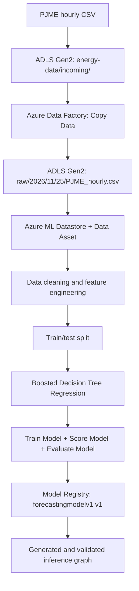

# Electricity Consumption Forecasting with Microsoft Azure

**An end-to-end academic Data Engineering and Machine Learning project** using Azure Data Lake Storage Gen2, Azure Data Factory, and Azure Machine Learning Designer.

| Project information | Details |
| --- | --- |
| **Author** | **Amine SAHHOUTI** |
| **Institution** | YouCode Safi |
| **Academic year** | 2026–2027 |
| **Implementation** | November 2026 |
| **Cloud region** | North Europe |
| **Dataset** | PJME Hourly Electricity Consumption |
| **ML task** | Electricity consumption regression / forecasting |
| **Algorithm** | Boosted Decision Tree Regression |
| **Project status** | Training completed, model registered, inference graph validated; no live endpoint demonstrated |

## 1. Project overview

The goal is to build and document a cloud-based workflow for predicting hourly electricity consumption (in **MW**) using historical PJME observations. The project covers CSV ingestion, data lake organization, preprocessing, feature engineering, model training, evaluation, model registration, and generation of a real-time inference *pipeline graph*.

The implementation was built through the **Azure Portal**, **Azure Data Factory Studio**, and **Azure Machine Learning Studio**, primarily using visual interfaces rather than a source-code application. This README records the reproducible configuration and observed outcomes; it does not imply an automated one-click deployment.

## 2. Architecture



> **Scope:** Generating and validating an inference pipeline is **not** the same as provisioning a publicly accessible real-time API. No successfully deployed endpoint or live API predictions are evidenced in the supplied materials.

## 3. Azure services

| Service | Purpose |
| --- | --- |
| Azure Storage Account | Hosts cloud object storage with hierarchical namespace enabled |
| Azure Data Lake Storage Gen2 (ADLS Gen2) | Stores incoming and date-organized raw CSV files |
| Azure Data Factory (ADF) | Copies and orchestrates file ingestion |
| Azure Machine Learning Workspace | Organizes ML assets, jobs, models, and experiments |
| Azure ML Datastore | References the ADLS Gen2 storage location |
| Azure ML Data Asset | Versions and references the source CSV |
| Azure ML Compute Cluster | Executes pipeline components on CPU machines |
| Azure ML Designer | Builds training and inference graphs visually |
| Azure ML Model Registry | Registers trained model artifacts |
| Azure managed identities + RBAC | Controls workload authentication and storage access |

## 4. Dataset and data lake

**Dataset:** PJME Hourly Electricity Consumption (`PJME_hourly.csv`).

| Column | Meaning |
| --- | --- |
| `Datetime` | Timestamp of hourly observation |
| `PJME_MW` | Electricity consumption, measured in megawatts; regression target |

A representative storage layout is:

```text
energy-data/                    # ADLS Gen2 filesystem/container
├── incoming/
│   └── pjme-hourly-....csv      # Initial uploaded CSV (source filename may vary)
├── raw/
│   └── 2026/
│       └── 11/
│           └── 25/
│               └── PJME_hourly.csv
└── processed/                  # Prepared for processed outputs; writing here not verified
```

Date partitioning of `raw/` improves ingestion traceability and supports reproducible data processing. The date in the path is the **ingestion organization date**, not necessarily the date of every historical observation in the CSV.

## 5. Implementation walkthrough

### Step 1 — Create the resource group and ADLS Gen2 storage

1. Sign in to [Azure Portal](https://portal.azure.com/) and select the educational subscription `formation-devops-simplon`.
2. Create or select the resource group used for the exercise.
3. Create a **StorageV2** account in **North Europe**, using **Standard** performance, **LRS** replication, and **Hot** access tier.
4. Enable **Hierarchical namespace** for ADLS Gen2 functionality.
5. Create a filesystem/container named `energy-data` and the directories `incoming/`, `raw/`, and `processed/`.
6. Upload the source CSV to `incoming/`.

Storage settings visible during implementation included encrypted storage, required secure transfer, TLS 1.2, disabled anonymous blob access, and enabled public network access. Public network access was a lab choice, **not** production network isolation.

### Step 2 — Ingest CSV data with Azure Data Factory

1. Create an Azure Data Factory resource and open **ADF Studio**.
2. Create the ADLS Gen2 linked service `LS_ADLS_Energy`.
3. Open the **Copy Data** wizard.
4. Choose the uploaded CSV in `energy-data/incoming/` as the source.
5. Set the destination to `energy-data/raw/2026/11/25/PJME_hourly.csv`.
6. Use **None** for compression. For the source, the wizard also offered binary-copy settings.
7. Use task/pipeline name `PL_Ingest_PJME_Raw` and configure data consistency checking as shown in the implementation.
8. Review, deploy, and run the copy job. Verify the **Succeeded** status and check that the output file exists in the raw path.

The wizard's deployment report confirmed successful dataset creation, pipeline creation, and execution. ADF can create destination subdirectories during a successful write when the target filesystem and permissions are valid.

### Step 3 — Create the Azure ML workspace and datastore

1. Create an **Azure Machine Learning Workspace** in **North Europe** using Microsoft-managed encryption keys.
2. Configure workspace identity/access according to the educational subscription's permitted settings.
3. Open [Azure ML Studio](https://ml.azure.com/).
4. Under **Data → Datastores**, create an ADLS Gen2 datastore (named `ds_energy_raw` in the documented setup), pointing to the `energy-data` filesystem.
5. Verify that authentication and storage data access work; a datastore's creation alone does not prove the compute cluster can read files.

**Naming note:** Some early screenshots show different student/workspace/storage naming conventions. When recreating the project, use one internally consistent set of account, resource group, datastore, and identity values; do not combine paths from different Azure environments.

### Step 4 — Create the Azure ML compute cluster

Create a **CPU compute cluster** with the following settings:

| Parameter | Configuration |
| --- | --- |
| Example name | `cpu-energy-forecasting` |
| Region | North Europe |
| VM size | `Standard_D11_v2` |
| vCPU / RAM | 2 vCPU / 14 GB RAM |
| Local storage shown | 100 GB |
| Minimum nodes | 0 |
| Maximum nodes | 1 |
| Autoscale | Enabled |
| SSH | Disabled |
| VM price shown in setup | Approximately $0.18 per node-hour (not total billed spend) |

Minimum nodes = 0 allows compute to scale down when idle. Confirm current quotas and availability before attempting to recreate the cluster.

### Step 5 — Register the source Data Asset

1. Open **Data → Data assets → Create**.
2. Select a file-based data asset, connected through the ADLS Gen2 datastore.
3. Browse to `raw/2026/11/25/PJME_hourly.csv`.
4. Register the asset (named `pjme-hourly-data`, version 1 in the earlier implementation; later screenshots may show an author-specific asset name).
5. Confirm that the correct **file** is selected, rather than a parent folder without a compatible MLTable definition.

### Step 6 — Build the training pipeline in Azure ML Designer

The training graph `PL_PJME_Forecasting_Training` contained the following stages:

1. **Data Asset** – input hourly CSV.
2. **Clean Missing Data** – handle missing observations.
3. **Summarize Data** – examine descriptive data summaries (a separate branch).
4. **Remove Duplicate Rows** – reduce duplicate records.
5. **Edit Metadata** – specify/adjust data metadata and types.
6. **Execute Python Script** – parse timestamps, order rows, repair missing-hour sequences, and produce time-based/lag features.
7. **Select Columns in Dataset** – select model features and target.
8. **Split Data** – produce training and test partitions.
9. **Boosted Decision Tree Regression** – provide the regression algorithm.
10. **Train Model** – fit the algorithm on the training partition.
11. **Score Model** – generate predictions on the held-out partition.
12. **Evaluate Model** – calculate regression metrics.

Example engineered features include **hour**, **day**, **month**, **day of week**, and historical lags of **1, 24, and 168 hours**. These reflect hourly, daily, and weekly electricity-use patterns.

> **Important time-series caveat:** The exact split configuration was not proven to be chronological. A conventional random split can produce optimistic forecasting estimates when temporal leakage is present. A future iteration should explicitly use a time-ordered split and confirm that lag features never use future observations.

### Step 7 — Run, troubleshoot, and evaluate

The original Azure ML job failed while trying to read source data:

```text
ScriptExecution.StreamAccess.Authentication
PermissionDenied(Some(NoIdentityOnCompute))
```

The troubleshooting process involved reading the job's `Outputs + logs`, examining the compute cluster's managed identity, and checking storage IAM/RBAC access. The intended remediation was to enable the compute's **system-assigned managed identity** and grant it the necessary storage data-reading role (such as **Storage Blob Data Reader**) at the appropriate scope. The student custom role did not permit assigning RBAC roles directly, so administrator assistance was necessary. The precise administrative change is not documented here.

After resolving the access issues, the training run **completed successfully**. The completed job in `exp-pjme-forecasting` showed green success indicators for the pipeline components.

### Step 8 — Evaluate the model

Actual Azure ML **Evaluate Model** output:

| Regression metric | Value |
| --- | ---: |
| Coefficient of determination (R²) | **0.6194527** |
| Mean Absolute Error (MAE) | **3,067.913 MW** |
| Root Mean Squared Error (RMSE) | **4,002.552 MW** |
| Relative Absolute Error | **0.6087938** |
| Relative Squared Error | **0.3805473** |

**Interpretation:** The evaluated model explains approximately **61.9% of the variation** in the target observations (R²). Average absolute error is approximately **3,068 MW**, while RMSE is around **4,003 MW**, indicating some larger errors. Results are moderate; performance can potentially be improved with chronological validation, hyperparameter search, weather/seasonality features, and careful feature engineering.

These are **regression errors**, not a classification accuracy percentage.

### Step 9 — Register the trained model

From the successful **Train Model** component:

1. Open **Outputs + logs → Register model**.
2. Choose the job output `trained_model_outputs`.
3. Use **Unspecified type** during selection; the registered model appears as **CUSTOM**.
4. Register as **`forecastingmodelv1`**, **version 1**.
5. Verify the registered model in **Models**.

The artifacts included `_meta.yaml`, `_samples.json`, `_schema.json`, `conda_env.yaml`, `data.ilearner`, `model_spec.yaml`, and `score.py`. Keeping them together helps preserve the trained model and its scoring metadata.

### Step 10 — Generate and validate the inference graph

1. Generate the **real-time inference pipeline** from the completed training pipeline.
2. Confirm the generated **Apply Transformation** step and that the trained-model artifact feeds **Score Model**.
3. Retain the data preparation steps necessary for prediction.
4. Remove the unnecessary **Evaluate Model** node from the inference copy.
5. Verify **Score Model → Web Service Output**.
6. Save and select **Validate**.

The resulting graph, `PL_PJME_Forecasting_Training-real time inference`, displayed:

```text
The pipeline looks good, you can submit or publish now
```

This is evidence of **graph validation only**. The final full-graph screenshot did not show a connected dynamic Web Service Input, and there is **no evidence of a running real-time endpoint**, a deployed web service, or a successful API prediction request.

## 6. Governance, security, and reproducibility

The brief also requires a governance approach:

- **Data quality:** date parsing, missing-value handling, duplicate removal, summaries, data-type checks.
- **Provenance:** date-organized raw paths, ADF run history, Azure ML Data Asset versions, job histories, and model version.
- **Access control:** RBAC and workload managed identities; give compute only required storage permissions.
- **Data protection:** encryption at rest, TLS, secure transfer, no anonymous blob access; evaluate private networking for production.
- **Retention:** specify who owns the data, how long it is retained, and when it is deleted.
- **Privacy:** assess whether a dataset contains personal information before making GDPR/RGPD compliance claims.

A useful data catalog entry should record: data source, `PJME_hourly.csv`, format CSV, `Datetime`, `PJME_MW`, ADLS storage path, asset name/version, transformation description, model artifact/version, access owners, and retention policy.

## 7. Costs and operational notes

- The VM selection screen showed **approximately $0.18/hour** for `Standard_D11_v2` in that environment.
- Actual charges depend on active node runtime, storage, ADF activities, and other Azure resources.
- **Min nodes = 0** limits idle compute costs, but does not make all Azure resources free.
- A final **Cost Management** bill or total-project expenditure is **not evidenced** in the supplied screenshots.
- Review or delete unneeded resources after the lab to avoid further charges.

## 8. Results and project status

| Deliverable | Status |
| --- | --- |
| ADLS Gen2 configuration and raw CSV organization | Completed |
| ADF Copy Data deployment and run | Completed |
| Azure ML datastore and registered data asset | Completed |
| CPU compute cluster | Created and used |
| Designer preprocessing/training/evaluation pipeline | Completed |
| Model evaluation metrics | Captured |
| Registered model `forecastingmodelv1:1` | Completed |
| Generated inference pipeline and validation | Completed |
| Deployed real-time inference endpoint | **Not demonstrated** |
| Live API prediction test | **Not demonstrated** |
| Final Azure billed cost | **Not documented** |

## 9. Project documentation and screenshots

The screenshot archive is named `screenshots.zip`. Its filenames are numbered by project step:

| Range | Contents |
| --- | --- |
| 01–08 | Resource groups, Storage Account, ADLS Gen2 structure, CSV upload |
| 09–18 | Azure Data Factory configuration and successful ingestion |
| 20–26 | Raw CSV, Azure ML workspace, datastore, compute and data asset |
| 27–28 | Preprocessing, training and evaluation graph |
| 29–30 | Job history and successful ML pipeline run |
| 31 | Actual evaluation metrics |
| 32–34 | Trained artifacts, registration wizard, registered model |
| 35 | Validated real-time inference graph |

**Archive note:** The supplied ZIP contains **34 screenshots**, numbered 01–18 and 20–35. **Screenshot 19 is missing**; do not assume it exists or invent its contents.

The full accompanying report is:

`Rapport_Azure_Data_Engineering_Machine_Learning_Amine_SAHHOUTI.docx`

If publishing this project to GitHub, a suggested structure is:

```text
azure-energy-forecasting/
├── README.md
├── docs/
│   └── Rapport_Azure_Data_Engineering_Machine_Learning_Amine_SAHHOUTI.docx
└── screenshots/
    ├── 01-resource-groups.png
    ├── ...
    └── 35-inference-pipeline-validation.png
```

Do not commit Azure credentials, storage account keys, client secrets, private connection strings, or unredacted sensitive information. Review screenshots for account identifiers before making the repository public.

## 10. Future improvements

- Use an explicitly **chronological** validation split with no look-ahead leakage.
- Compare boosted trees with other regressors, including time-series baselines.
- Tune hyperparameters and review feature importance.
- Add weather, public holiday and seasonal signals where justified.
- Validate real-time feature generation using only data available at prediction time.
- Create and test a supported real-time API endpoint separately from graph validation.
- Add model monitoring, drift detection, automated retraining, and cost alerts.

## Author

**Amine SAHHOUTI**  
YouCode Safi · Academic Year 2026–2027

---

*Educational implementation documented from Azure screenshots and project execution notes. Resource names and prices are environment-specific; confirm them before recreating the lab.*
